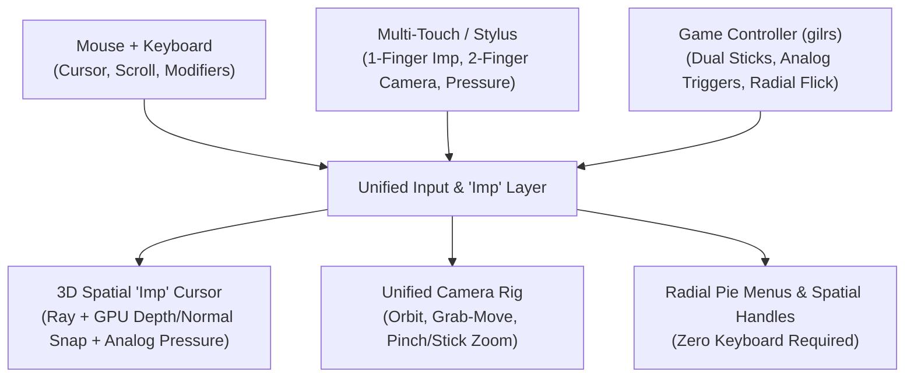

# Traum Engine — Architecture & Development Plan

> **Vision:** A playful, tactile 3D creation engine inspired by Media Molecule's *Dreams*, built in Rust and `wgpu`. Sculpt painterly worlds out of Signed Distance Fields (SDFs) rendered with living brushstrokes ("flecks"), animate creations like toys, and jump instantly between creating and playing—seamlessly across **Mouse & Keyboard, Touch, and Game Controllers**.

---

## 1. Feasibility Assessment

### What Makes *Dreams* Hard vs. Achievable
Media Molecule spent ~7 years with 50+ engineers building *Dreams* because it combined **five** massive products into one: an SDF sculpting engine, a custom point-cloud ("fleck") renderer, a visual scripting engine, a full DAW music studio, and an online sharing platform—all squeezed onto a base 2013 PS4 GPU.

Building **all five** at once is not realistic for a small/solo project. However, building **the signature look and creative magic of *Dreams***—**real-time SDF sculpting, painterly "fleck" rendering with looseness & bokeh depth-of-field, toy-like animation, and instant play-mode**—is **very feasible** today in Rust + `wgpu`:
1. **Modern GPU Compute Headroom:** Desktop and modern tablet/integrated GPUs have vastly more compute throughput and VRAM than a 2013 PS4, making compute-driven SDF bricks and GPU-instanced painterly fleck splatting fast and clean in WGSL without PS4-specific GCN assembly tricks.
2. **Bounded SDF + Fleck Architecture:** Baking CSG brush strokes into **Sparse SDF Voxel Bricks** and extracting **Surface Flecks** only along the surface shell keeps rendering cost bounded regardless of whether a sculpt has 10 or 10,000 brush strokes.
3. **Unified Input & Modular Rust Ecosystem:** `winit` (mouse, keyboard, native multi-touch) + `gilrs` (game controllers with analog triggers/sticks) let us build a hardware-agnostic **"Imp" & Gesture System** from day one, paired with `glam`, `hecs`, `rapier3d`, and `kira`.

---

## 2. How the *Dreams*-Style Graphics & SDF Engine Work

### Why Pure Shader-Toy Raymarching Isn't Enough
1. **Performance:** Evaluating hundreds of raw CSG primitives per pixel kills framerates as sculpts grow.
2. **Aesthetic:** Pure SDF raymarching looks like smooth plastic/vinyl (*Claybook* / *MagicaCSG*), **not** like *Dreams*' warm, living, hand-painted illustration world.

### The *Dreams* Pipeline: CSG Edits -> Sparse SDF Bricks -> Surface "Flecks"
Just like Media Molecule's architecture, Traum Engine separates **shape representation (SDFs)** from **surface rendering (Painterly Flecks)**:

```mermaid
flowchart LR
    A["Brush Stroke\n(Shape, Blend, Color,\nLooseness, Fleck Style)"] --> B["Sculpt Edit List\n(Lossless History / Undo)"]
    B --> C["Compute Pass 1:\nEvaluate Dirty 8x8x8 SDF Bricks"]
    C --> D["Sparse SDF Brick Atlas\n(Distance + Color + Looseness)"]
    D --> E["Compute Pass 2:\nIso-Surface Point & Tangent Extractor"]
    E --> F["Surface Fleck Cloud\n(GPU Buffer per Sculpt Asset)"]
    F --> G["Render Pass:\nInstanced Fleck Splatting + SDF Shadows/AO"]
    G --> H["Post-Process:\nTAA + Tilt-Shift Bokeh DOF + Warm Bloom"]
```



1. **Sculpt Asset = Non-Destructive CSG Edit List:**
   Every Sculpt stores an ordered list of **CSG Edits** (`Add`, `Subtract`, `SmoothBlend`, `Paint`, `Loosen`) with primitive shapes (`Sphere`, `RoundedBox`, `Capsule`, `Cylinder`, `Cone`, `Torus`, `Curve`), blend radius (`k`), color/roughness, **Looseness**, and **Fleck Brush Type** (impasto paint, chalk, watercolor, grass, cloud puff).
   - Non-destructive edits give **infinite undo**, live re-tweaking of past strokes, and tiny save files.
2. **Sparse 8×8×8 SDF Brick Atlas (Compute Pass 1):**
   - Active surface regions allocate `8×8×8` bricks inside a GPU 3D Texture Atlas. Empty air and deep interiors allocate **zero** bricks.
   - Dragging a brush only re-evaluates bricks overlapping the brush bounding box -> **sub-millisecond real-time sculpting**.
3. **Surface Fleck Extraction & Hybrid Tightness (Compute Pass 2):**
   - A WGSL compute shader scans active surface bricks near the zero-crossing (`|d| < threshold`), computes the exact surface position (`p - d * ∇d`) and surface normal (`∇d`), and emits **Surface Flecks** into a compact GPU buffer.
   - **Avoiding Ugly Holes on Tight Surfaces:** In PS4 *Dreams*, tight flat surfaces sometimes shimmered or had pinholes before TAA converged. On modern GPUs, we use a **Hybrid Tight-to-Loose Continuum**:
     - At **Low Looseness** (carved stone, crisp toys, metal): an underlying tight SDF/micro-splat base guarantees zero pinholes while subtle surface flecks add painterly brushwork texture.
     - At **High Looseness** (foliage, clouds, fur, sketchy clay): large, rotated, overlapping textured brush quads billow outward around the SDF shell with stochastic alpha / TAA accumulation!
4. **Lighting & Atmosphere (The *Dreams* Signature Look):**
   - **SDF Cone-Traced Soft Shadows & Ambient Occlusion:** Because we still have the 3D SDF brick atlas in VRAM, flecks can sample the SDF field directly for ultra-soft contact shadows, ambient occlusion, and warm subsurface wrap-lighting (clay/wax translucency)!
   - **Miniature Camera Feel:** Built-in **Bokeh Depth of Field**, atmospheric color haze (distant objects tint softly toward sky bounce), warm sky/ground hemisphere GI, and subtle film grain.

---

## 3. Unified Input Architecture: Mouse/KB + Touch + Game Controller

To avoid bolting touch or controller support onto a keyboard-centric app later, **zero editor tools will read raw mouse buttons or keys directly**. Everything goes through a unified **Imp & Action Layer**:



| Action | Mouse + Keyboard | Touch / Tablet | Game Controller |
| :--- | :--- | :--- | :--- |
| **Move "Imp" (3D Cursor)** | Mouse move | 1-finger move / Stylus hover | Right Stick (or Left Stick w/ Imp mode) |
| **Stamp / Paint / Grab** | `Left Click / Drag` | `1-Finger Drag` (Stylus pressure -> size/blend) | `R2` Analog Trigger (pull depth -> size/pressure!) |
| **Subtract / Carve** | `Alt + Left Drag` (or mode chip) | On-screen `Add/Carve` toggle pill + `1-Finger Drag` | `L2` + `R2` (or `Triangle/Y` mode toggle) |
| **Orbit / Pan / Zoom Camera** | `Right-Drag` / `Middle-Drag` / `Wheel` + `WASD` | `2-Finger Twist/Drag` (Orbit/Pan) + `Pinch` (Zoom) | `Left + Right Sticks` + `L1` Grab-cam (classic *Dreams* cam) |
| **Tool & Brush Picker** | `Space` / `Right-Click` Radial Menu | Tap floating Radial Button -> drag-release | Hold `L1 / LB` + flick Stick to slice |
| **Adjust Brush Size / Blend** | `Scroll` / `Shift+Scroll` or drag 3D handle | Pinch on 3D brush ring / drag world-space tab | `D-Pad` or `L1 + Stick` on 3D brush ring |
| **Undo / Redo** | `Ctrl+Z` / `Ctrl+Y` | `2-Finger Tap` (Undo) / `3-Finger Tap` (Redo) + UI buttons | `Left / Right D-Pad` |

### UI Rules for Cross-Input Playfulness
- **No tiny 14px inspector dropdowns** as primary workflow: every core action lives in **large bouncy radial menus**, **floating pill toggles**, or **direct 3D handles attached to the object/brush**.
- **Analog Expression:** Gamepad triggers (`0.0..1.0`) and touch/stylus pressure dynamically modulate brush scale, blend softness, or looseness as you draw!

---

## 3.5 Smart Upgrades Over *Dreams* (Fixing *Dreams*' Biggest Pain Points + New Ideas)

Because we aren't constrained to a 2013 PS4 or DualShock gyro hardware, we can improve on *Dreams* in four major ways:

1. **Watertight Clay Core + Painterly Fleck Coat (No "Fizzy" Blur):**
   - *The PS4 Trap:* Pure point-cloud splatting in *Dreams* caused flat walls and fast-moving characters to look "fizzy", blurry, or full of pinholes.
   - *Our Upgrade:* Render a **watertight SDF clay core** (with impasto brush-stroke normal maps + warm subsurface wax bounce) underneath **true 3D billowing flecks** driven by `Looseness`. Crisp toys stay razor-sharp in motion, while clouds, foliage, fur, and loose brushwork billow into lush painterly strokes.
2. **"Surface-Magnet Imp" + Drop-Shadow Depth Guides (Fixing Floaty 3D Controls):**
   - *The PS4 Trap:* *Dreams*' #1 player complaint was getting lost in 3D space while waving a gyroscope controller in mid-air.
   - *Our Upgrade:* No gyro gymnastics needed. Across Mouse, Touch, and Gamepad sticks, the Imp acts like a **smart surface magnet**—gliding along existing surfaces, and smoothly locking onto an intuitive depth plane with a **vertical ground drop-shadow line** whenever you sculpt into open air so depth is always crystal clear.
3. **"Living Flecks" (Instant 12fps Stop-Motion & Wind Life):**
   - *New Idea:* Give flecks optional shader-driven micro-life out of the box—*Breeze* (leaves/grass gently sway), *Stop-Motion Boil* (brushstrokes subtly dance at 12fps like *Spider-Verse* / hand-drawn claymation), and *Drift* (clouds/sparks softly churn). A sculpted forest feels alive before you place a single keyframe!
4. **Never Open to a Blank Grey Grid ("Diorama Island Starter"):**
   - *New Idea:* Boot directly onto a sunlit, floating clay diorama island sitting in warm clouds—made of real editable SDF clay so your very first click can carve a cave into the island, pull up a mountain, or drop in a bouncy puppet.

---

## 4. Recommended Tech Stack

Why **Custom Engine on `wgpu`** instead of full **Bevy**?
> Full `Bevy` (`bevy_pbr`) is built around triangle meshes and standard PBR shaders. Fighting its render graph to run sparse 3D SDF brick compute passes, custom GPU iso-surface fleck splatting, stochastic TAA, and GPU-buffer Imp picking creates massive friction. Building directly on **`wgpu` + modular Rust crates** gives us 100% control over the *Dreams*-style rendering and input pipeline.

| Layer | Crate / Choice | Why |
| :--- | :--- | :--- |
| **GPU & Compute** | `wgpu` (WGSL) + `bytemuck` | Compute shaders for SDF bricks & fleck extraction, instanced quad splatting, cross-platform (Vulkan/DX12/Metal). |
| **Window & Touch** | `winit` | Windowing, raw mouse, keyboard, and native `Touch` events (`Started`, `Moved`, `Ended`, multi-finger tracking). |
| **Gamepads** | `gilrs` | Plug-and-play Xbox, DualSense/DualShock, Switch Pro controllers with analog sticks, triggers, and rumble haptics! |
| **Math** | `glam` | Fast SIMD vectors, quaternions, affine transforms. |
| **World / ECS** | `hecs` | Lightweight, fast ECS for sculpt instances, puppet joints, lights, and animation tracks. |
| **UI Rendering** | Custom SDF/Vector Radial UI + `egui` | Custom GPU-drawn bouncy radial menus/pills for touch/gamepad/mouse; `egui` kept only for optional developer debug stats. |
| **Physics** | `rapier3d` | Rigid bodies, joints, character controllers driven by coarse SDF collision proxies. |
| **Audio & Foley** | `kira` | Game audio + interactive UI sound toys (clay squishes, brush whooshes, pops) + controller rumble sync. |
| **Serialization** | `serde` + `ron` / `postcard` | Clean scene files + fast binary sculpt edit lists. |

---

## 5. Animation System ("Bring Toys to Life")

In *Dreams*, you never paint vertex skinning weights. Characters and contraptions are **multi-part rigid sculpts** connected like stop-motion puppets:

1. **Puppet Hierarchies & Connectors:**
   - Connect sculpts with **Ball Joints**, **Hinges**, **Sliders**, or **Spring Connectors**—works identically with mouse drag, finger drag, or gamepad Imp grab!
2. **"Action Recorder" (Performative Animation):**
   - Tap **Record**, grab any object or puppet limb with the Imp (mouse, finger, or controller trigger), and **move/wiggle it live** while the beat plays. Traum Engine records, smooths, and loops your performance automatically.
3. **Pose Flipbook Cards:**
   - Pose your creation -> tap `+ Pose` -> pose again. Pick transition feel per card: *Smooth, Spring/Overshoot, Linear, Stop-Motion Steppy*.
4. **Toy Motion Gadgets (Zero-Keyframe Life):**
   - Drag-and-drop badges onto any sculpt: **Wobble**, **Float/Hover**, **Spin**, **Squash & Stretch**, **Look At Imp/Player**.

---

## 6. Phased Development Roadmap

Every milestone produces a playable, tactile build you can test immediately with mouse, touch, or controller.

### Milestone 1: The Painterly SDF & "Imp" Sandbox (Weeks 1–2)
- Cargo workspace setup (`traum-core`, `traum-input`, `traum-sdf`, `traum-render`, `traum-editor`, `traum-app`).
- **Unified Input & Imp System:** Mouse + Keyboard, `winit` multi-touch gestures (1-finger sculpt, 2-finger orbit/pinch), and `gilrs` gamepad support (dual-stick camera + analog trigger brush + rumble).
- **Single-Sculpt SDF + Fleck Pipeline:**
  - WGSL compute shader evaluating CSG Edit Lists (`Sphere`, `RoundedBox`, `Capsule`, `Cylinder`, `Cone` with `Add`, `Subtract`, `SmoothBlend`, `Color`, and `Looseness`) into `8×8×8` SDF bricks.
  - Iso-surface **Fleck Extractor** compute pass + **Painterly Fleck Splat Renderer** with SDF soft shadows, ambient occlusion, warm hemisphere bounce, and bokeh Depth of Field.
- GPU Imp surface picking (exact 3D hit point + normal snapping) and `Undo / Redo`.

### Milestone 2: Sparse World Atlas, Radial Toy UI & Cloning (Weeks 3–4)
- Global **Sparse 3D Brick Atlas** + Scene BVH supporting hundreds of independent sculpt instances at different scales.
- **Touch/Gamepad/Mouse Radial Pie Menus** & world-space 3D handles (adjust blend softness, looseness, brush fleck texture, and color palette right in 3D space).
- **Live Clone, Mirror Symmetry, & Kaleidoscope Arrays** + Save/Load scenes & reusable stamps.
- Temporal Anti-Aliasing (TAA) & stochastic fleck refinement for lush loose foliage/clouds.

### Milestone 3: Puppets & Performative Animation (Weeks 5–6)
- Multi-sculpt hierarchies, ball/hinge joints, and 2-bone IK for puppet limbs.
- **Live Action Recorder** (puppeteer objects in real time with mouse, touch, or controller) + **Pose Flipbook** cards with spring easing.
- Procedural motion badges (*Hover*, *Spin*, *Wobble*, *Bounce*).

### Milestone 4: Instant Play Mode, Physics & Character Toy (Weeks 7–9)
- Zero-load-time `Edit <-> Play` toggle & rewind state snapshot.
- `rapier3d` physics integration (compound sphere/coarse mesh colliders auto-extracted from SDF bricks).
- Drop-in **Playable Dreams-Style Puppet** (walk, jump, procedural bouncy walk cycle controllable via WASD, virtual touch stick, or gamepad!).
- Simple visual trigger wires (*Touch Zone -> Play Animation / Sound / Impulse*).

### Milestone 5: Visual & Audio Juice Pass (Weeks 10+)
- Expanded fleck library (oil impasto, chalk pastel, watercolor, glowing embers, grass blades) + emissive SDF glow bounce.
- Procedural tactile foley sounds (`kira`) + gamepad haptic feedback on surface contact and sculpting.

---

## 7. Key Technical Risks & Mitigations

| Risk | Why It Happens | Mitigation Strategy |
| :--- | :--- | :--- |
| **Pinholes or Shimmering in Flecks** | Pure point splats leave gaps when zoomed in or at low density. | **Hybrid Tight-to-Loose Rendering:** Tight surfaces keep a watertight SDF/dense micro-splat base + impasto normal/brush detail; loose surfaces billow outward with stochastic TAA. |
| **Fleck Overdraw on Loose Clouds/Grass** | Overlapping large alpha-blended brush quads hurt fillrate. | Use **Alpha-to-Coverage / Stochastic Stippling + TAA** (opaque depth-tested dithered brush masks!)—this is the exact secret *Dreams* used to avoid expensive alpha-sorting! |
| **VRAM Growth Across Many Sculpts** | Dense 3D volumes eat gigabytes quickly. | Allocate `8×8×8` bricks **only** within the narrow surface band (`|d| < brick_band`), and share one Sculpt asset across N cloned instances. |
| **Clunky Cross-Device UX** | Keyboard shortcuts don't exist on touchscreens or gamepads. | Enforce the **Unified Action & Radial UI rule** from Milestone 1: every feature must be usable via Imp + Radial Menu + 3D Handle before any keyboard shortcut is added. |

---

## 8. Proposed Crate Structure

```text
traumengine/
├── Cargo.toml                  # Workspace root
├── docs/
│   └── PLAN.md                 # Architecture & roadmap document
└── crates/
    ├── traum-core/             # Math, ECS, Sculpt Edit Lists, Animation curves, Save/Load
    ├── traum-input/            # Unified Imp, Camera gestures, Mouse/KB + Multi-Touch + Gamepad (gilrs)
    ├── traum-sdf/              # Sparse 8x8x8 Brick Pool, CSG primitives, Collider proxy extraction
    ├── traum-render/           # wgpu pipelines: SDF Compute -> Fleck Extractor -> Splat Renderer + SDF AO/Shadows + Bokeh DOF/TAA
    ├── traum-physics/          # Rapier3D world, joints, playable puppet controller
    ├── traum-editor/           # Sculpt/Paint/Clone tools, Radial menus, 3D handles, Action Recorder, Undo/Redo
    └── traum-app/              # Window loop, audio foley (kira), Edit <-> Play state machine
```
